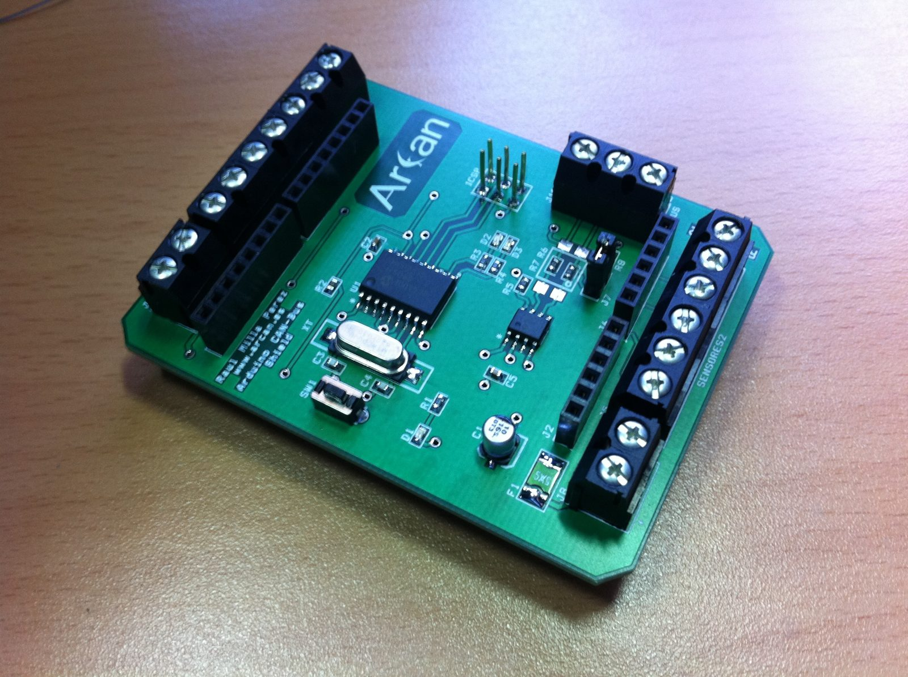
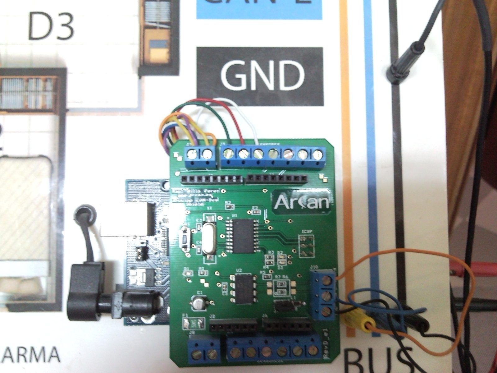
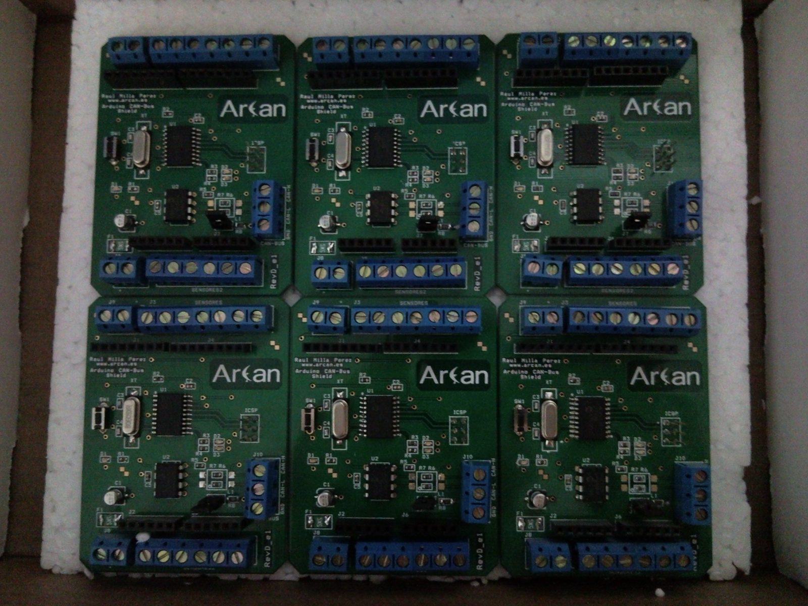

# ArCan: CAN-Bus shield and MCP2515 library for Arduino



**ArCan** is an open-source CAN-Bus shield for Arduino and the library that drives it, built around the Microchip **MCP2515** CAN controller. It lets an Arduino send and receive CAN frames to talk to vehicles, industrial equipment and other CAN networks.

It was designed in 2009 by **Raúl Milla Pérez ([DominicZe](https://dominicze.com))** while studying Telecommunications Engineering in Málaga, was presented on the [Arduino forum](https://forum.arduino.cc/t/shield-arcan-interfaz-arduino-can-bus/32219), and served as the basis for final-year engineering projects at the University of Las Palmas de Gran Canaria (ULPGC).

- Project page, photos and history: https://dominicze.com/proyectos/arcan-can-bus-arduino/
- YouTube (machine restoration, CNC and LinuxCNC retrofits): https://www.youtube.com/@DominicZe
- Original repository (SVN, 2011-2013): https://sourceforge.net/projects/arcan/. The full history has been migrated here.

## Features

- Standard 11-bit CAN frames, data and remote (RTR)
- Bus speeds of 125, 250, 500 and 1000 kbps (MCP2515 with a 16 MHz crystal)
- Acceptance masks and filters for both receive buffers
- Normal, listen-only, loopback, sleep and configuration modes
- Small receive queue of 8 frames inside the library

## Hardware

The library talks to the MCP2515 directly through the AVR SPI registers, so it targets **ATmega328/168 boards**: Arduino Uno, Duemilanove and Nano.

| Signal | Arduino pin |
|---|---|
| CS | 10 |
| MOSI / MISO / SCK | 11 / 12 / 13 |
| INT | 9 |

Other boards (Mega, Leonardo, ARM) need the pin and SPI definitions in `ArCan_def.h` and `ArCan.cpp` to be adapted.

## Installation

1. Download this repository as a ZIP (**Code → Download ZIP**) or a [release](https://github.com/DominicZe-DZ/ArCan/releases).
2. In the Arduino IDE: **Sketch → Include Library → Add .ZIP Library…**
3. Open **File → Examples → ArCan → ArCan_Basic**.

## Usage

```cpp
#include <ArCan.h>

tArCan can;

void setup() {
  Serial.begin(115200);
  can.begin(125);                      // 125, 250, 500 or 1000 kbps
}

void loop() {
  if (digitalRead(ArCan_INT) == LOW)   // a frame is waiting in the MCP2515
    can.get_message_to_buffer_rx();

  while (can.check_message()) {
    tArCan::tCAN msg;
    can.get_message(&msg);
    can.print_message(&msg);
  }
}
```

| Method | Description |
|---|---|
| `begin()` / `begin(speed)` | Resets and configures the MCP2515 (125 kbps by default). Returns `false` if the chip does not answer. |
| `send_message(&msg)` | Sends a frame using the first free transmit buffer. Returns 0 if all buffers are busy. |
| `get_message_to_buffer_rx()` | Moves a received frame from the MCP2515 to the library queue. |
| `check_message()` | `true` if there are frames in the queue. |
| `get_message(&msg)` | Takes a frame from the queue. |
| `print_message(&msg)` | Prints a frame on the serial port. |
| `SetMode(mode)` | `NORMAL`, `LISTEN`, `LOOPBACK`, `SLEEP` or `CONFIGURATION`. |
| `SetRXB0Filters(mask, f0, f1)` | Mask and two filters for receive buffer 0. |
| `SetRXB1Filters(mask, f2, f3, f4, f5)` | Mask and four filters for receive buffer 1. |

## History and mentions

- **2009, Arduino forum:** [presentation of the ArCan shield](https://forum.arduino.cc/t/shield-arcan-interfaz-arduino-can-bus/32219).
- **2008/09, III Concurso Universitario de Software Libre** (Spanish university free-software contest): ArCan took part [for the University of Málaga](https://concursosoftwarelibre.org/0809/proyectos.html).
- **May 2009, Linux Magazine (Spanish edition) nº 49, Community section, pp. 88-92:** "3er. Concurso Universitario de Software Libre: los proyectos de los nuevos desarrolladores españoles", including ArCan ([issue record](https://dialnet.unirioja.es/ejemplar/222069), [announcement](http://www.concursosoftwarelibre.org/0809/planet1c5d.html?%24Path=&%24Version=1&page=14)).
- **University of Las Palmas de Gran Canaria (ULPGC):** final-year projects built on the ArCan library ([1](https://hdl.handle.net/10553/9860), [2](https://hdl.handle.net/10553/10146), [3](https://hdl.handle.net/10553/25512)).
- **Other projects:** [MazCAN Project](http://mazcanproject.sourceforge.net/blog/), whose first version was built on Arduino and the ArCan shield.
- **Videos (2014):** [Proyecto ArCan (Arduino + CAN BUS)](https://www.youtube.com/watch?v=BhLxdrJ59ms) and [an OBD-II car diagnosis system using ArCan](https://www.youtube.com/watch?v=Iw-ZMyqEr5c).

## License

Software: **MIT License**. You can use, modify and sell it, including commercially. The only condition is to keep the copyright notice, which credits the author. See [LICENSE](LICENSE).

Shield hardware design: **CERN Open Hardware Licence v2 – Permissive (CERN-OHL-P)**, with the same spirit: free use, keeping the credit to the author.

Versions up to 2013 (tags `ArCan_1.00`, `ArCan_1.10` and SVN history) were published under GPL-2.0-or-later. From version 2.0.0 the author relicenses the project under MIT.

---

## En español

**ArCan** es un shield CAN-Bus de código abierto para Arduino, con su librería para el controlador **MCP2515** de Microchip. Permite que un Arduino envíe y reciba tramas CAN para comunicarse con coches, equipos industriales y cualquier red CAN.

Lo diseñó en 2009 **Raúl Milla Pérez ([DominicZe](https://dominicze.com))** cuando estudiaba Ingeniería de Telecomunicación en Málaga. Se presentó en el [foro de Arduino](https://forum.arduino.cc/t/shield-arcan-interfaz-arduino-can-bus/32219) y sirvió de base para trabajos de fin de grado de la Universidad de Las Palmas de Gran Canaria (ULPGC).

**Instalación:** descarga el ZIP del repositorio y en el IDE de Arduino usa *Programa → Incluir librería → Añadir biblioteca .ZIP*. El ejemplo está en *Archivo → Ejemplos → ArCan → ArCan_Basic*.

**Licencia:** MIT. Puedes usarlo, modificarlo y venderlo, también con fines comerciales, siempre que mantengas el aviso de copyright con el nombre del autor.

Más información, fotos e historia del proyecto: https://dominicze.com/proyectos/arcan-can-bus-arduino/



